<p align="center">
  
</p>

<h1 align="center">Secret Party 🍸</h1>

<p align="center">
  Una red social para encontrar fiestas y <i>hangs</i>, al estilo Tinder.<br>
  Proyecto de semestre de <b>Ingeniería Web</b>, hecho con <b>ASP.NET Core MVC (.NET 10)</b>.
</p>

<p align="center">
  
  
  
  
</p>

<p align="center">
  🌐 <b>Demo en línea:</b> <a href="https://secretparty.runasp.net">secretparty.runasp.net</a>
</p>

---

## 📋 Tabla de contenidos

- [Sobre el proyecto](#-sobre-el-proyecto)
- [Capturas de pantalla](#-capturas-de-pantalla)
- [Funcionalidades](#-funcionalidades)
- [Panel de administración](#-panel-de-administración)
- [Patrones de diseño: trazas, retry y fallback](#-patrones-de-diseño-trazas-retry-y-fallback)
- [Requisitos de la tarea](#-requisitos-de-la-tarea)
- [Tecnologías](#-tecnologías)
- [Cómo ejecutarlo](#-cómo-ejecutarlo)
- [Rutas de la aplicación](#-rutas-de-la-aplicación)
- [Seguridad](#-seguridad)
- [Estructura del proyecto](#-estructura-del-proyecto)
- [Problemas comunes](#-problemas-comunes)
- [Próximos pasos](#-próximos-pasos)
- [Créditos](#-créditos)

---

## 💜 Sobre el proyecto

**Secret Party** es una app web donde cada persona tiene su perfil para encontrar fiestas y planes. Es **solo para mayores de 18 años**.

**Entrega 1: la base de cualquier red social**

- **Registro e inicio de sesión** con email y contraseña.
- **Un perfil propio** que cada usuario puede ver, editar y eliminar.
- **Páginas privadas** a las que no se puede entrar sin iniciar sesión.

**Entrega 2: la administración que alimenta la app**

- Un **panel de administración** al que solo entra el rol **Admin**.
- **Moderación**: el admin puede flaguear perfiles que rompen las reglas y eliminar a los que acumulan muchos flags, como en Tinder.
- **Validación de edad 18+ en el back-end**, el dato sensible de la app.

**Entrega 3: patrones de diseño del paper**

- **Trazas** de lo que pasa dentro de la app y una página de **Observabilidad** en el admin.
- **Modo caos**: el admin puede hacer fallar partes de la app a propósito.
- Los patrones **Retry** y **Fallback** en el chat, Google Calendar y la foto de perfil.

El diseño viene de un prototipo propio en **Figma**: colores lila y verde lima, botones tipo pastilla, la letra Poppins y un fondo con notas musicales, lunas y estrellas. Es **mobile first** y se adapta a pantallas de computadora (responsive).

---

## 📸 Capturas de pantalla

|                                  Inicio                                   |                            Login                            |                             Registro                              |
| :-----------------------------------------------------------------------: | :---------------------------------------------------------: | :---------------------------------------------------------------: |
| 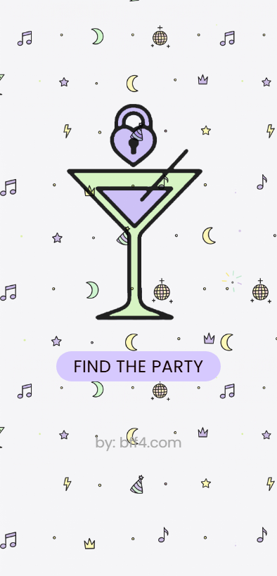 | 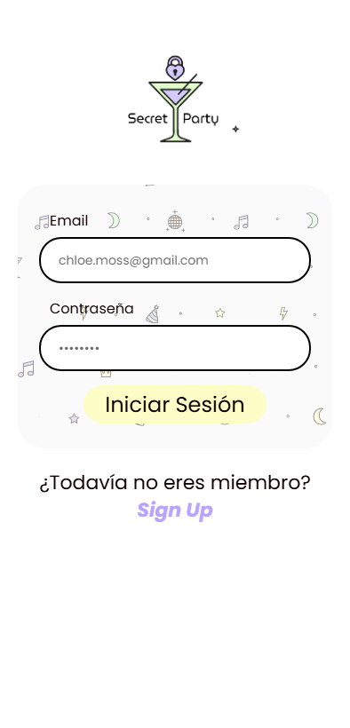 | 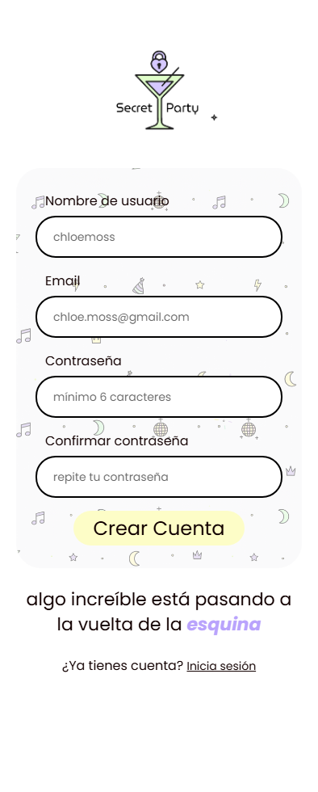 |

|                     Configura tu cuenta (editar)                     |                            Mi perfil                             |                              Privacidad                               |
| :------------------------------------------------------------------: | :--------------------------------------------------------------: | :-------------------------------------------------------------------: |
| 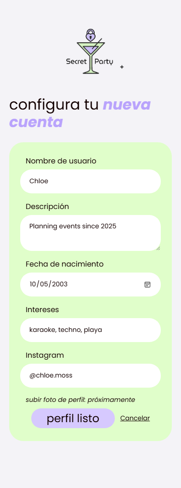 | 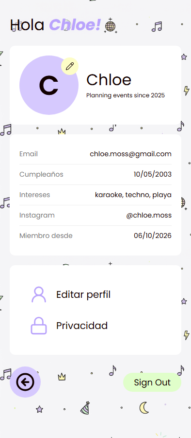 | 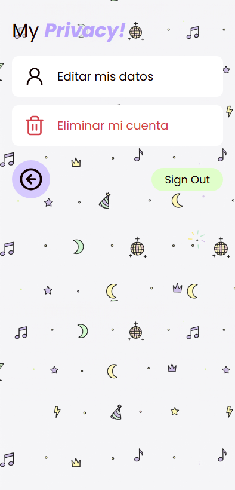 |

**En computadora**, el perfil se acomoda en dos columnas:

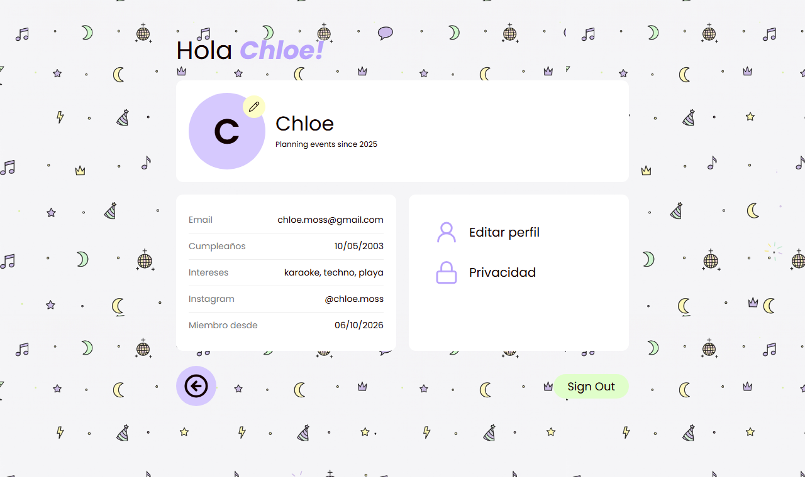

### Panel de administración

|                                      Dashboard                                      |                                          Usuarios                                          |
| :---------------------------------------------------------------------------------: | :----------------------------------------------------------------------------------------: |
| 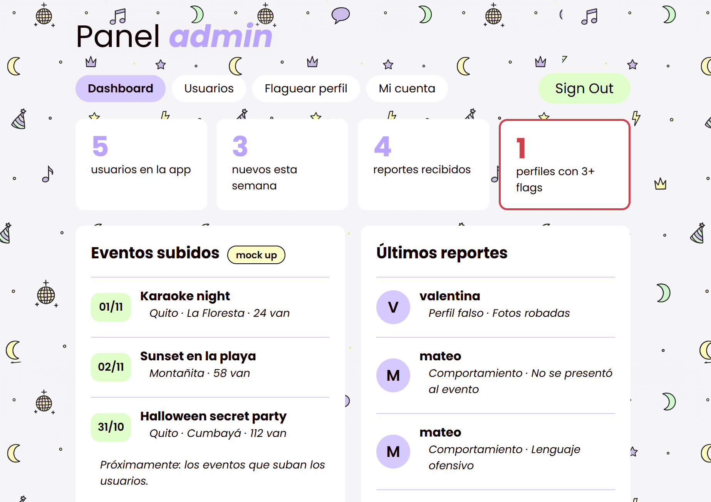 | 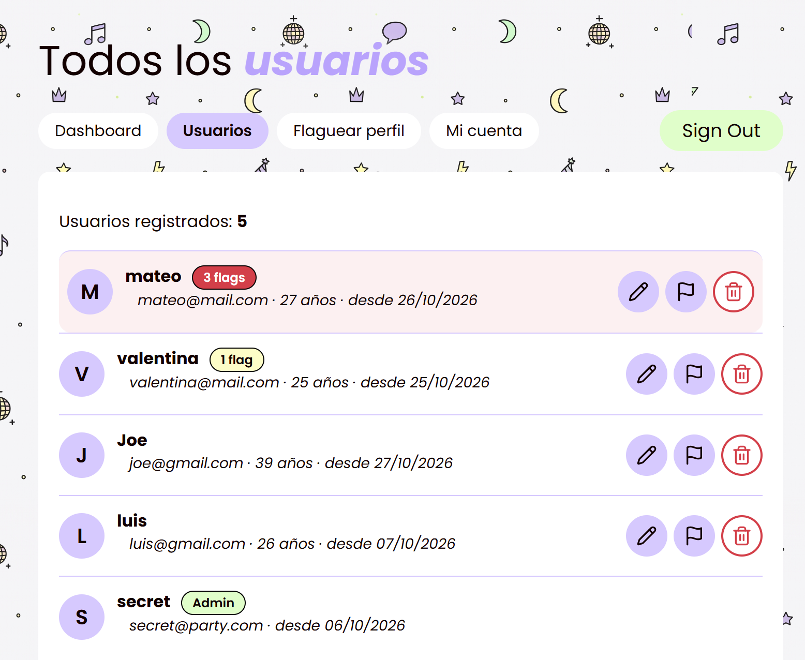 |

|                        Flaguear perfil (dropdowns en cascada)                        |                         Validación de edad en el back-end                         |
| :----------------------------------------------------------------------------------: | :-------------------------------------------------------------------------------: |
| 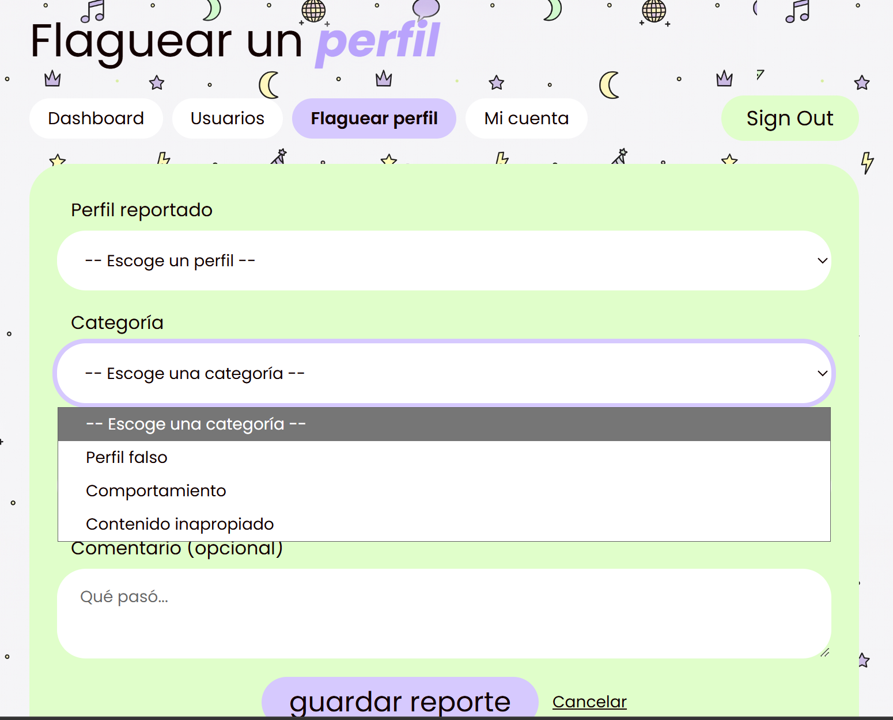 | 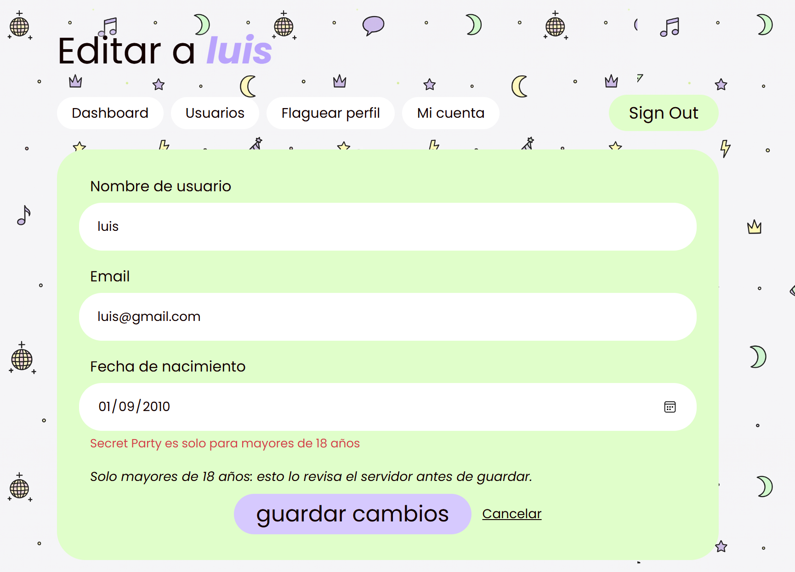 |

---

## ✨ Funcionalidades

- **Crear cuenta** con nombre de usuario, email, fecha de nacimiento y contraseña. Valida que el email y el nombre no estén ocupados y que la persona sea **mayor de 18**.
- **Iniciar y cerrar sesión** con cookies. La sesión dura 2 horas.
- **Configurar el perfil**: descripción, fecha de nacimiento, intereses e Instagram.
- **Ver mi perfil** ("Hola Chloe!") con todos mis datos.
- **Eliminar mi cuenta**, con una pantalla de confirmación antes de borrar.
- **Páginas protegidas**: si no has iniciado sesión, te manda al login, y después de entrar te regresa a la página que querías ver.
- **Diseño responsive**: una columna en celular y dos columnas en computadora.

---

## 👑 Panel de administración

El admin **no tiene perfil social**: al iniciar sesión entra directo a su panel y, si intenta abrir `/Perfil`, la app lo regresa al panel.

| Sección              | Qué hace                                                                                                                                                                                                                       |
| -------------------- | ------------------------------------------------------------------------------------------------------------------------------------------------------------------------------------------------------------------------------ |
| **Dashboard**        | Números reales sacados de la base: usuarios en la app, nuevos esta semana, reportes recibidos y perfiles con 3 o más flags. También muestra los últimos reportes. La lista de _eventos subidos_ por ahora es un **mock up**.   |
| **Usuarios**         | Lista de todos los usuarios con su **edad** y su número de **flags**. Los que tienen 3 o más flags, o que son menores de edad, salen marcados en rojo. Desde aquí se puede **editar**, **flaguear** o **eliminar** a cada uno. |
| **Editar usuario**   | El admin puede corregir nombre, email y fecha de nacimiento. Pasa por la misma **validación de 18+** en el servidor.                                                                                                           |
| **Eliminar usuario** | Antes de borrar muestra todos los reportes de esa persona, para decidir con información. Sus reportes se borran con ella (borrado en cascada).                                                                                 |
| **Flaguear perfil**  | Formulario con **3 dropdowns**: perfil → **categoría** → **motivo**. Al escoger la categoría se cargan solo sus motivos.                                                                                                       |
| **Mi cuenta**        | Los datos del admin, sin salir del panel.                                                                                                                                                                                      |

### Modelo de datos

```
CategoriaReporte 1 ──── * MotivoReporte 1 ──── * Reporte * ──── 1 Usuario
 (Perfil falso,           (Fotos robadas,         (el flag)         (el perfil
  Comportamiento, ...)     Acoso, ...)                               reportado)
```

Las categorías y los motivos se cargan solos con la migración (`HasData` en `AppDbContext`).

### Cómo ser admin

En `appsettings.json` va el email de la cuenta que será admin:

```json
"Admin": {
  "Email": "secret@party.com"
}
```

Al arrancar, la app busca esa cuenta y le pone `EsAdmin = true`. Primero hay que **registrar** la cuenta con ese email y luego reiniciar la app. Así no se guarda ninguna contraseña en el código.

---

## 🧩 Patrones de diseño: trazas, retry y fallback

Esta parte aplica el artículo _Mining Design Patterns from Distributed Execution Traces_ (Ramasubramanian et al., 2022). El artículo propone **descubrir patrones de diseño mirando las trazas de ejecución** (qué pasó de verdad cuando el sistema corría), en vez de leer el código. Se enfoca en tres patrones:

| Patrón       | Qué es                                                            |
| ------------ | ----------------------------------------------------------------- |
| **Retry**    | Si un servicio falla, se vuelve a intentar el **mismo** servicio. |
| **Fallback** | Si un servicio falla, se usa un **plan B** con **otro** servicio. |
| **Caching**  | Se guardan en memoria datos que se piden seguido.                 |

El artículo advierte que **reintentar sin límite y sin plan B es un antipatrón**. Por eso en Secret Party cada retry tiene un máximo de intentos y termina en un fallback.

Seguimos el mismo método del paper, en tres pasos:

### 1. Trazas: registrar qué pasó

Cada operación importante guarda una fila en la tabla **`Trazas`**: la **operación** (qué se quería lograr), el **servicio** que lo intentó, si funcionó o **falló**, cuánto tardó y a qué **petición** pertenece. El paper usa Jaeger; nosotros guardamos las trazas en nuestra propia base SQLite.

- [`Models/Traza.cs`](Models/Traza.cs): la tabla.
- [`Servicios/Rastreador.cs`](Servicios/Rastreador.cs): guarda las trazas con una conexión aparte, para que una traza nunca rompa la app.
- **Admin → Observabilidad**: las últimas 100 trazas, con cuántas funcionaron y cuántas fallaron.

### 2. Modo caos: inyectar fallas a propósito

Las fallas reales son raras e impredecibles, así que, igual que en el paper, las **provocamos**. En **Admin → Modo caos** se escoge qué servicio hacer fallar y con qué probabilidad (0 %, 50 % o 100 %). Hay un botón **Probar** que usa el servicio 10 veces y deja cada intento como traza.

- [`Servicios/Caos.cs`](Servicios/Caos.cs): el inyector. Es un _singleton_: una sola configuración para toda la app, que vuelve a apagarse al reiniciar.

### 3. Retry + Fallback: cómo reacciona la app

[`Servicios/Resiliencia.cs`](Servicios/Resiliencia.cs) aplica los dos patrones en un solo lugar: intenta el servicio **hasta 3 veces**, esperando cada vez más (100 ms, 200 ms), y si sigue fallando usa el **plan B**. Cada intento queda como traza.

| Dónde                     | Servicio principal | Plan B (fallback)                                          |
| ------------------------- | ------------------ | ---------------------------------------------------------- |
| Chat: mensajes nuevos     | `BaseDeDatos`      | `ModoSinConexion`: aviso rojo _"Sin conexión con el chat"_ |
| Agregar a Google Calendar | `GoogleCalendar`   | `ArchivoIcs`: se descarga el archivo `.ics`                |
| Foto de perfil            | `AlmacenFotos`     | `FotoAnterior`: se queda la foto que ya tenía              |

En el navegador, [`wwwroot/js/chat.js`](wwwroot/js/chat.js) también reintenta con **espera creciente** (4 s → 8 s → 16 s → 30 s) si el servidor no responde, en vez de insistir cada 4 segundos para siempre.

En **Observabilidad** se ven las secuencias de cada patrón:

```
Retry que funcionó:   ChatNuevos → BaseDeDatos ❌  →  ChatNuevos → BaseDeDatos ✅
Fallback:             ChatNuevos → BaseDeDatos ❌ ❌ ❌  →  ChatNuevos → ModoSinConexion ✅
```

### Probarlo

1. Entra como admin → **Modo caos** → pon `BaseDeDatos`, `GoogleCalendar` y `AlmacenFotos` al **100 %** → **Guardar**.
2. En una ventana de incógnito, entra con un usuario normal:
   - Abre un **chat** → sale el aviso _"Sin conexión con el chat"_.
   - En un hang tuyo, dale a **Google Calendar** → se descarga el `.ics` en vez de abrir Google.
   - **Cambia tu foto** → sale un aviso y se queda la foto anterior.
3. Vuelve al admin → **Observabilidad**: aparecen los tres intentos fallidos y luego el plan B.
4. Con **50 %** también aparecen retries que funcionan al segundo o tercer intento.
5. **Apagar todo** → la app vuelve a la normalidad.

### Referencia

Ramasubramanian, K., Phillips, E., & Alvaro, P. (2022). _Mining design patterns from distributed execution traces_ [Artículo corto]. ACM Symposium on Cloud Computing (SoCC '22). https://kamalaramas.github.io/mining_design_patterns.pdf

---

## ✅ Requisitos de la tarea

| Requisito                                                   | Cómo se cumple                                                                                                          |
| ----------------------------------------------------------- | ----------------------------------------------------------------------------------------------------------------------- |
| App con patrón **MVC**                                      | `Models/` (datos), `Views/` (vistas Razor), `Controllers/` (lógica)                                                     |
| **CRUD**                                                    | **C**rear → `/Cuenta/Registro` · **R**eer → `/Perfil` · **U**pdate → `/Perfil/Editar` · **D**elete → `/Perfil/Eliminar` |
| **Login** con usuario y contraseña                          | `CuentaController` con autenticación por cookies y contraseñas guardadas como hash                                      |
| El usuario accede a una **sección protegida** (CRUD)        | `PerfilController` tiene `[Authorize]` en toda la clase                                                                 |
| Las **URLs protegidas** no son accesibles sin autenticación | Abrir `/Perfil` sin sesión → redirige a `/Cuenta/Login?ReturnUrl=%2FPerfil`                                             |

### Entrega 2: Administración MVC

| Requisito                                                           | Cómo se cumple                                                                                                                                                                                                                                                                                                                      |
| ------------------------------------------------------------------- | ----------------------------------------------------------------------------------------------------------------------------------------------------------------------------------------------------------------------------------------------------------------------------------------------------------------------------------- |
| Administración **MVC** que alimenta el core                         | `AdminController` + `Views/Admin/`: dashboard, usuarios y reportes                                                                                                                                                                                                                                                                  |
| Validación en el **back-end** de un **dato sensible**               | La **edad (18+)**. La regla está en [`Models/Edad.cs`](Models/Edad.cs) y se revisa en el **controlador**, antes de `SaveChanges()`, en `Cuenta/Registro`, `Perfil/Editar` y `Admin/EditarUsuario`. **No hay JavaScript** validando la edad: aunque alguien envíe el formulario a mano, el servidor lo rechaza.                      |
| Las **claves foráneas** se eligen con **dropdown**, no con un input | En _Flaguear perfil_ el perfil, la categoría y el motivo son `<select>`. El de motivos está **en cascada**: al cambiar la categoría, JavaScript llama a `/Admin/MotivosPorCategoria?categoriaId=…` y lo rellena solo con los motivos de esa categoría. El servidor además comprueba que el motivo **sí pertenezca** a la categoría. |
| Código versionado en **Git** con README                             | Este repositorio                                                                                                                                                                                                                                                                                                                    |
| **Deploy** en un servidor (no localhost)                            | **https://secretparty.runasp.net**, en [MonsterASP.NET](https://www.monsterasp.net) (hosting gratis de .NET, con HTTPS de Let's Encrypt). Se publica con `dotnet publish -c Release` y se sube por FTPS.                                                                                                                            |

---

## 🛠 Tecnologías

- **ASP.NET Core MVC** sobre **.NET 10**
- **Entity Framework Core 10** + **SQLite**: base de datos en un archivo, con migraciones
- **Autenticación por cookies** (`Microsoft.AspNetCore.Authentication.Cookies`)
- **`PasswordHasher`** de ASP.NET Core Identity para encriptar contraseñas
- **Razor** + **Tag Helpers** para las vistas
- **CSS propio** (sin Bootstrap): variables, flexbox, grid y media queries
- **Roles** en la cookie (`ClaimTypes.Role`) + `[Authorize(Roles = "Admin")]`
- **Fetch API** (JavaScript) para los dropdowns en cascada y el chat, con reintentos y espera creciente
- **Inyección de dependencias** de ASP.NET Core (`Scoped` y `Singleton`) para los servicios de trazas, caos y resiliencia
- **jQuery Validation** para validar los formularios en el navegador (la edad la valida solo el servidor)
- **Google Fonts** (Poppins) e iconos SVG de **Lucide**

---

## 🚀 Cómo ejecutarlo

### Requisitos

- [.NET 10 SDK](https://dotnet.microsoft.com/download)
- Git

### Pasos

```bash
# 1. Clonar el repositorio
git clone https://github.com/epixkraken/SecretParty.git
cd SecretParty

# 2. Ejecutar la app
dotnet run
```

3. Abrir en el navegador **http://localhost:5023**.

> 💡 **No hace falta crear la base de datos a mano.** Al arrancar, la app aplica las migraciones sola (`Database.Migrate()` en `Program.cs`) y crea el archivo `secretparty.db`.

### Probarlo en 1 minuto

1. Abre **http://localhost:5023/Perfil** sin iniciar sesión → te manda al **Login** 🔒.
2. Dale a **Sign Up** y crea una cuenta.
3. Llena tu perfil en **"configura tu nueva cuenta"** → **perfil listo**.
4. **Sign Out** y vuelve a abrir `/Perfil` → te bloquea otra vez.
5. Intenta registrarte con una fecha de nacimiento de **menor de 18** → el servidor no crea la cuenta.

### Probar el panel admin

1. Pon tu email en `"Admin": { "Email": ... }` dentro de `appsettings.json` y reinicia la app.
2. Inicia sesión → caes en el **Dashboard**.
3. En **Flaguear perfil**, escoge una categoría y mira cómo cambian los motivos.
4. En **Usuarios**, edita a alguien y ponle una fecha de menor → el servidor no lo guarda.
5. Inicia sesión con una cuenta normal y abre `/Admin` → **Acceso denegado**.

---

## 🗺 Rutas de la aplicación

| Ruta                                      | Método     | ¿Protegida? | Qué hace                                                      |
| ----------------------------------------- | ---------- | :---------: | ------------------------------------------------------------- |
| `/`                                       | GET        |      —      | Pantalla de inicio ("FIND THE PARTY")                         |
| `/Cuenta/Registro`                        | GET / POST |      —      | Formulario de registro / crea la cuenta                       |
| `/Cuenta/Login`                           | GET / POST |      —      | Formulario de login / inicia sesión                           |
| `/Cuenta/Logout`                          | POST       |      —      | Cierra sesión                                                 |
| `/Perfil`                                 | GET        |     🔒      | Ver mi perfil                                                 |
| `/Perfil/Editar`                          | GET / POST |     🔒      | Formulario de edición / guarda los cambios                    |
| `/Perfil/Eliminar`                        | GET / POST |     🔒      | Confirmación / elimina la cuenta                              |
| `/Home/Privacy`                           | GET        |     🔒      | Opciones de privacidad                                        |
| `/Cuenta/AccesoDenegado`                  | GET        |      —      | Para quien tiene sesión pero no es admin                      |
| `/Admin`                                  | GET        |     👑      | Dashboard                                                     |
| `/Admin/Usuarios`                         | GET        |     👑      | Lista de usuarios con edad y flags                            |
| `/Admin/EditarUsuario/{id}`               | GET / POST |     👑      | Corregir un usuario (valida 18+)                              |
| `/Admin/EliminarUsuario/{id}`             | GET / POST |     👑      | Confirmación / elimina al usuario                             |
| `/Admin/NuevoReporte`                     | GET / POST |     👑      | Flaguear un perfil                                            |
| `/Admin/MotivosPorCategoria?categoriaId=` | GET        |     👑      | JSON con los motivos de una categoría (para la cascada)       |
| `/Admin/MiCuenta`                         | GET        |     👑      | Datos del admin                                               |
| `/Admin/Observabilidad`                   | GET        |     👑      | Las últimas trazas: qué funcionó y qué falló                  |
| `/Admin/ModoCaos`                         | GET / POST |     👑      | Configurar el inyector de fallas                              |
| `/Admin/ProbarCaos`                       | POST       |     👑      | Usa un servicio 10 veces y deja las trazas                    |
| `/Admin/ApagarCaos`                       | POST       |     👑      | Apaga todas las fallas                                        |
| `/Calendario/Google/{id}`                 | GET        |     🔒      | Abre Google Calendar; si falla, descarga el `.ics` (fallback) |

🔒 = necesita sesión · 👑 = necesita sesión **y** rol Admin

---

## 🔐 Seguridad

| Medida                                                            | Qué evita                                                                                           |
| ----------------------------------------------------------------- | --------------------------------------------------------------------------------------------------- |
| `[Authorize]` en `PerfilController` y en `Privacy`                | Entrar a páginas privadas sin sesión                                                                |
| El Id del usuario se toma **de la cookie, nunca de la URL**       | Que alguien edite o borre la cuenta de **otra persona** cambiando un número en la URL               |
| Contraseñas con **hash + sal** (`PasswordHasher`)                 | Que se lean las contraseñas si alguien obtiene la base de datos                                     |
| `[ValidateAntiForgeryToken]` en todos los POST                    | Ataques **CSRF** (que otra web envíe formularios usando tu sesión)                                  |
| **ViewModels** para los formularios                               | **Overposting** (que alguien cambie campos como `Email` o `PasswordHash` agregándolos a escondidas) |
| Eliminar solo por **POST** y con confirmación                     | Borrar la cuenta sin querer, con un simple link                                                     |
| `Url.IsLocalUrl(ReturnUrl)`                                       | **Open redirect** (usar el login para mandarte a una web falsa)                                     |
| Mensaje genérico "Email o contraseña incorrectos"                 | Averiguar qué emails están registrados                                                              |
| Índices **únicos** en email y nombre de usuario                   | Cuentas duplicadas                                                                                  |
| `[Authorize(Roles = "Admin")]` en `AdminController`               | Que un usuario normal entre al panel escribiendo `/Admin` en la URL                                 |
| `OnActionExecuting` en `PerfilController`                         | Que el admin termine en páginas de usuario normal                                                   |
| **Edad 18+ validada en el servidor** (`Edad.cs`)                  | Que un menor se registre o que alguien cambie su fecha, aunque se salte el navegador                |
| El servidor comprueba que el **motivo pertenezca a la categoría** | Guardar reportes incoherentes editando el HTML del formulario                                       |
| El admin no puede editar ni eliminar a **otro admin**             | Que se borre la única cuenta con permisos                                                           |

---

## 📁 Estructura del proyecto

```
SecretParty/
├── Program.cs               # Configuración: base de datos, cookies, rutas
├── Controllers/
│   ├── HomeController.cs    # Inicio y Privacidad
│   ├── CuentaController.cs  # Registro, Login, Logout, Acceso denegado
│   ├── PerfilController.cs  # Ver, Editar, Eliminar perfil  🔒
│   └── AdminController.cs   # Dashboard, usuarios y reportes  👑
├── Models/
│   ├── Usuario.cs           # Entidad que se guarda en la base de datos
│   ├── Reporte.cs           # CategoriaReporte, MotivoReporte y Reporte
│   ├── Edad.cs              # Regla de 18+ (validación del dato sensible)
│   ├── Traza.cs             # Una traza: qué pasó, en qué servicio y si falló
│   ├── CuentaViewModels.cs  # Formularios de Login y Registro
│   ├── PerfilViewModels.cs  # Formulario de Editar perfil
│   └── AdminViewModels.cs   # Dashboard, editar usuario y flaguear
├── Data/
│   └── AppDbContext.cs      # Contexto de Entity Framework
├── Servicios/
│   ├── Rastreador.cs        # Guarda las trazas
│   ├── Caos.cs              # Inyector de fallas (modo caos)
│   └── Resiliencia.cs       # Patrones Retry + Fallback
├── Migrations/              # Migraciones de la base de datos
├── Views/
│   ├── Shared/              # _Layout (marco común) e _Icono (iconos SVG)
│   ├── Home/                # Index, Privacy
│   ├── Cuenta/              # Login, Registro, AccesoDenegado
│   ├── Perfil/              # Index, Editar, Eliminar
│   └── Admin/               # Index, Usuarios, EditarUsuario, EliminarUsuario, NuevoReporte, MiCuenta
├── wwwroot/
│   ├── css/site.css         # Todo el diseño
│   └── img/                 # Logos y patrón de fondo
└── docs/capturas/           # Capturas para este README
```

---

## 🧯 Problemas comunes

**Windows bloquea la app al hacer `dotnet run`** ("Una directiva de Control de aplicaciones bloqueó este archivo")

El _Control inteligente de aplicaciones_ de Windows 11 bloquea los programas que no están firmados, y eso incluye los que compilas tú. El proyecto ya tiene `<UseAppHost>false</UseAppHost>` en el `.csproj` para no generar un `.exe`. Si aun así se bloquea la `.dll`, hay que desactivar el Control inteligente en **Seguridad de Windows → Control de aplicaciones y navegador**. Windows Defender sigue protegiendo el equipo.

---

## 🔮 Próximos pasos

- [x] Deploy en un servidor
- [ ] Tabla real de eventos para reemplazar el mock up del dashboard
- [ ] Que los usuarios puedan flaguear perfiles desde la app
- [x] Subir foto de perfil
- [x] Crear _hangs_ (fiestas) con fotos
- [x] Ver solicitudes y mensajes
- [x] Trazas, modo caos, retry y fallback (patrones del paper)
- [ ] Detectar los patrones automáticamente con consultas SQL sobre las trazas
- [ ] Rating con estrellas y contador de hangs

---

## 🙌 Créditos

- **Equipo:** Domenica Teran ([@epixkraken](https://github.com/epixkraken)) y Luis Pozo
- **Iconos:** [Lucide](https://lucide.dev) (licencia MIT)
- **Tipografía:** [Poppins](https://fonts.google.com/specimen/Poppins) de Google Fonts
- **Materia:** Ingeniería Web, séptimo semestre
